  

  
  
  

---
### About
I build cloud data pipelines and learn by implementing end-to-end data engineering projects. My current focus is Azure Data Engineering: ingestion, incremental loading, lakehouse architecture, Spark, and data governance.

**Core stack:** Azure Data Factory · Azure Data Lake Storage Gen2 · Azure Databricks · PySpark · Delta Lake · Unity Catalog · SQL

### Featured project
**[End-to-End Azure Retail Data Engineering Pipeline](https://github.com/Tejass555/azure-retail-data-engineering-pipeline)**

An Azure-based retail data platform using metadata-driven ingestion, watermark-based incremental loading, and a Bronze–Silver–Gold lakehouse design.

### Connect
- [GitHub](https://github.com/Tejass555)
- [LinkedIn](https://www.linkedin.com/in/tejas-waghmare15/)

Activity cards are refreshed daily by GitHub Actions. Contribution counts come from GitHub's contribution calendar.
