# Animated GitHub Profile README --- Setup Guide

This guide explains how to build a GitHub profile README inspired by the
animated SVG-card design shown in the reference screenshots.

The design uses: - A profile hero card with your name, role, short
introduction, and optional ASCII portrait. - Three linked metric cards
(for example: projects, audience, and learning). - A monthly activity
chart. - A GitHub contribution heatmap. - Optional featured-repository
cards. - SVG animations that play when GitHub displays the images. - A
scheduled GitHub Actions workflow that refreshes the cards.

> **Important:** A GitHub README cannot run JavaScript or load its own
> CSS. The animation must be inside SVG files. GitHub Actions can
> generate those SVG files and commit the updated versions to your
> profile repository.

------------------------------------------------------------------------

## 1. What you need

Before starting, make sure you have:

1.  A GitHub account.
2.  Git installed on your computer.
3.  Python 3.10 or later.
4.  A code editor such as Visual Studio Code.
5.  A GitHub profile repository.

### Create your profile repository

Your profile repository must have exactly the same name as your GitHub
username.

For this example, the username is `Tejass555`, so the repository must
be:

``` text
Tejass555/Tejass555
```

If it does not exist:

1.  Open GitHub and select **New repository**.
2.  Enter `Tejass555` as the repository name.
3.  Set the repository to **Public**.
4.  Add a README if you want, then create the repository.
5.  Clone it:

``` bash
git clone https://github.com/Tejass555/Tejass555.git
cd Tejass555
```

If you already have a profile README, clone that repository and back it
up before replacing anything.

------------------------------------------------------------------------

## 2. How the design works

The README is the layout. The SVG files are the visual components. A
Python script generates the SVG files. GitHub Actions runs that script
on a schedule.

``` text
Tejass555/
├── README.md
├── cards/
│   ├── hero.svg
│   ├── build.svg
│   ├── brand.svg
│   ├── learn.svg
│   ├── activity.svg
│   └── contributions.svg
├── data/
│   └── contributions.json
├── scripts/
│   └── render_readme_cards.py
└── .github/
    └── workflows/
        └── refresh-profile.yml
```

You will create these folders and files during the setup. The Python
renderer and SVG templates are implementation files; this README is the
installation guide, not the renderer itself.

------------------------------------------------------------------------

## 3. Add the README layout

Open `README.md` and use this starter layout. Replace the example text
and links with your own information.

``` html
<div align="center">
  
</div>

<p align="center">
  <a href="https://github.com/Tejass555">
    
  </a>
  <a href="https://github.com/Tejass555">
    
  </a>
  <a href="https://github.com/Tejass555">
    
  </a>
</p>

<div align="center">
  
</div>

<div align="center">
  
</div>
```

The three cards are separate SVG images, so each can have its own link.
Keep image widths close to one-third so the cards fit in a row. GitHub's
Markdown renderer may display spacing differently on mobile and desktop,
so preview the result on both.

------------------------------------------------------------------------

## 4. Create the project folders

From the root of your cloned repository, run:

``` bash
mkdir -p cards data scripts .github/workflows
```

Your SVG generator should write the generated files into `cards/`. The
contribution-data collector should write its output to
`data/contributions.json`.

Do not put API tokens, passwords, or other secrets in the README, Python
source files, or JSON data.

------------------------------------------------------------------------

## 5. Collect GitHub contribution data

The contribution heatmap needs daily contribution counts. A common
approach is to use the GitHub GraphQL API.

1.  Create a GitHub Personal Access Token with only the permissions
    needed to read your own contribution data.
2.  Store it as a repository Actions secret named `GH_TOKEN`.
3.  Use a data-collection script to request the contribution calendar.
4.  Save the returned daily counts to `data/contributions.json`.

Example shape for the JSON file:

``` json
{
  "username": "Tejass555",
  "totalContributions": 120,
  "days": [
    {
      "date": "2026-01-01",
      "count": 2
    },
    {
      "date": "2026-01-02",
      "count": 0
    }
  ]
}
```

The values above are illustrative only. Your collector must replace them
with actual data from GitHub.

------------------------------------------------------------------------

## 6. Generate the SVG cards

Create `scripts/render_readme_cards.py`. Its job is to:

1.  Read `data/contributions.json`.
2.  Calculate monthly contribution totals.
3.  Find the busiest day and current activity streak, if your data
    collector supplies enough information.
4.  Render the hero, metric, monthly activity, and contribution SVG
    files.
5.  Write the files into `cards/`.

For SVG animation, use SVG-supported animation such as `<animate>` or
`<animateTransform>`, or CSS animation inside the SVG where supported by
the target renderer.

Useful animation ideas: - Reveal the hero text line by line. - Print an
ASCII portrait row by row. - Grow monthly bars upward from the
baseline. - Reveal contribution squares from left to right. - Animate a
subtle highlight across a metric card.

Keep the animation restrained. The information must remain readable when
animation is disabled.

### Respect reduced motion

Include a reduced-motion fallback where the SVG/CSS implementation
supports it. Also make sure the final static SVG frame looks complete,
because not every client displays SVG animation in the same way.

------------------------------------------------------------------------

## 7. Add the scheduled GitHub Actions workflow

Create `.github/workflows/refresh-profile.yml`.

A workflow should: 1. Run on a daily schedule and on manual dispatch. 2.
Check out the profile repository. 3. Set up Python. 4. Install the
renderer's dependencies. 5. Collect fresh contribution data. 6. Run
`scripts/render_readme_cards.py`. 7. Commit and push changed SVG and
JSON files.

A basic workflow structure:

``` yaml
name: Refresh profile cards

on:
  workflow_dispatch:
  schedule:
    - cron: "17 1 * * *"

permissions:
  contents: write

jobs:
  refresh:
    runs-on: ubuntu-latest
    steps:
      - name: Check out repository
        uses: actions/checkout@v4

      - name: Set up Python
        uses: actions/setup-python@v5
        with:
          python-version: "3.11"

      - name: Install dependencies
        run: |
          python -m pip install --upgrade pip
          # Add the packages required by your scripts here.

      - name: Collect contribution data
        env:
          GH_TOKEN: ${{ secrets.GH_TOKEN }}
        run: |
          # Run your contribution-data collector here.

      - name: Render SVG cards
        run: python scripts/render_readme_cards.py

      - name: Commit generated cards
        run: |
          git config user.name "github-actions[bot]"
          git config user.email "41898282+github-actions[bot]@users.noreply.github.com"
          git add cards data
          git diff --cached --quiet || git commit -m "Refresh profile cards"
          git push
```

This is a workflow skeleton, not a complete working pipeline: the
contribution collector, Python renderer, and their dependencies must
exist before the workflow can succeed. Add the collector command and
dependencies when you implement those scripts.

------------------------------------------------------------------------

## 8. Test it locally before publishing

Run the generator locally:

``` bash
python scripts/render_readme_cards.py
```

Then check that the expected SVG files exist:

``` text
cards/hero.svg
cards/build.svg
cards/brand.svg
cards/learn.svg
cards/activity.svg
cards/contributions.svg
```

Open the SVG files in a browser or an SVG viewer. Check: - Text is not
clipped. - Fonts render correctly. - The cards have consistent
dimensions. - The contribution chart uses real data. - The static end
state is readable. - Links in `README.md` point to the intended pages.

If your script supports a static-preview option, use it to inspect the
final frame without waiting for the animations.

------------------------------------------------------------------------

## 9. Publish the profile

Commit and push your changes:

``` bash
git add .
git commit -m "Build animated GitHub profile README"
git push origin main
```

If your default branch is named `master`, use `master` instead of
`main`.

Open:

``` text
https://github.com/Tejass555
```

Your profile README should appear on your GitHub profile. If the images
do not appear, check that the SVG paths and filenames match exactly and
that the files are committed to the default branch.

------------------------------------------------------------------------

## 10. Troubleshooting

  -----------------------------------------------------------------------
  Problem                             What to check
  ----------------------------------- -----------------------------------
  Images are missing                  Confirm the SVG files exist in the
                                      repository and the relative paths
                                      are correct.

  Workflow fails with permission      Check the workflow's
  errors                              `contents: write` permission and
                                      repository Actions settings.

  Contribution data is empty          Check the `GH_TOKEN` secret, token
                                      permissions, username, and GraphQL
                                      response.

  Workflow cannot find a Python file  Confirm the script path and
                                      filename match the workflow
                                      command.

  Fonts look different                Embed or use reliable fallback
                                      fonts; do not assume external fonts
                                      will load inside an SVG.

  Animation does not play             Check SVG animation support in the
                                      client. Keep a complete static
                                      appearance as a fallback.

  Workflow makes no commit            The generated files may be
                                      unchanged; this is normal when
                                      there is no difference.
  -----------------------------------------------------------------------

------------------------------------------------------------------------

## 11. Security and maintenance

-   Keep tokens in **GitHub Actions Secrets**, never in source code.
-   Use the smallest token permissions that work.
-   Review third-party Actions before using them.
-   Pin Actions to reviewed versions or commit SHAs in production
    workflows.
-   Do not claim live or daily-updated metrics unless the workflow
    actually refreshes them.
-   Check the Actions tab after the first manual run.
-   Keep a static, readable version of the profile for clients that do
    not support SVG animation.

------------------------------------------------------------------------

## 12. Recommended build order

Build one working piece at a time. Do not start with all animations at
once.

1.  Create the profile repository and a simple `README.md`.
2.  Add one static `hero.svg` and confirm it displays.
3.  Add the three linked metric cards.
4.  Add the contribution-data collector.
5.  Generate the monthly activity chart.
6.  Generate the contribution heatmap.
7.  Add animation to one SVG at a time.
8.  Add the scheduled GitHub Actions workflow.
9.  Test the workflow manually.
10. Check the profile on desktop and mobile.

**Definition of done:** the profile renders correctly, the data comes
from a real source, the scheduled workflow completes successfully, and
the README remains understandable when SVG animation is unavailable.

------------------------------------------------------------------------

## Important note

The reference design is not installed by copying a README alone. It
depends on supporting SVG files, Python generation code, contribution
data, and a GitHub Actions workflow. This guide gives you the repository
structure and setup sequence. The renderer and data collector still need
to be implemented and tested before the animated profile will work.
